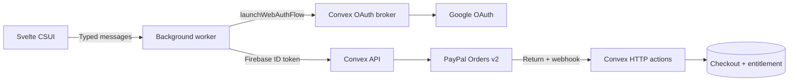

# Minimum PayPal Web Extension Example

A runnable Chrome MV3 and Firefox MV3 example for Google sign-in, Firebase sessions, Convex entitlements, and a fixed-price PayPal Orders v2 checkout.

The repository follows the deployment and environment discipline used by `youtube-time-manager`, reduced to one lifetime product. It supports multiple persistent Google accounts without copying client-bundled secrets, manually storing Google refresh tokens, subscriptions, analytics, or product-specific infrastructure.

## Flow



- Firebase Auth owns the user session.
- Convex verifies Firebase ID tokens and owns entitlements.
- PayPal and Google client secrets exist only in Convex deployment environment variables.
- The content script receives display state, never provider or Firebase tokens.
- Each Google account has an isolated Firebase Auth persistence namespace.
- Users can add, select, and remove accounts without signing the others out.

See [`docs/architecture.md`](docs/architecture.md) for detailed sequences and trust boundaries.

## What It Demonstrates

- One WXT/Svelte 5 codebase for Chrome and Firefox MV3
- Shadow-root Material 3 Expressive content-script UI
- Typed `@webext-core/messaging` calls to the background worker
- Persistent Firebase Auth in the background worker
- Schema-validated multi-account storage keyed by verified Google `sub`
- Google OAuth state, PKCE, nonce, signed-ID-token verification, and one-time handoff
- Fresh authenticated `ConvexHttpClient` instances for one-shot operations
- PayPal Orders v2 create and capture with stable idempotency keys
- Exact amount, currency, order, approval-host, and ownership validation
- Bounded, timestamped, provider-verified, deduplicated PayPal webhooks
- Transactional lifetime entitlement grants
- Automated lint, style, type, browser-build, dependency, dead-code, and unit checks

## Prerequisites

- Node.js 22 or newer
- pnpm 11.1.2 through Corepack
- A Google account for Firebase, Google Cloud, and Convex
- A PayPal Developer account

```sh
corepack enable
pnpm install
```

Provider callbacks require public HTTPS endpoints. A local-only Convex deployment cannot receive Google or PayPal callbacks.

## Guided Sandbox Setup

Complete Steps 1–6 in order. Use a dedicated development Firebase project, Convex deployment, and PayPal sandbox app. Do not copy credentials from another application or use PayPal Live credentials during this guide.

Keep this worksheet locally while configuring the providers. Values marked **secret** must be entered directly with `convex env set`; never paste them into an extension environment file, issue, screenshot, or commit.

| Record | Where to find it | Destination | Secret |
| --- | --- | --- | --- |
| Firebase `apiKey`, `appId`, `authDomain`, `projectId` | Firebase Web app settings | `extension/.env.local` | No |
| Convex `.convex.cloud` URL | Convex dashboard or CLI | `extension/.env.local` | No |
| Convex deployment selector | Created by Convex CLI | `backend/.env.local` | No |
| Google Web client ID | Google Cloud OAuth client | Convex environment | No |
| Google Web client secret | Google Cloud OAuth client | Convex environment | **Yes** |
| Chrome and Firefox identity URLs | Extension background consoles | Convex environment | No |
| PayPal sandbox client ID | PayPal sandbox app | Convex environment | No |
| PayPal sandbox secret | PayPal sandbox app | Convex environment | **Yes** |
| PayPal sandbox webhook ID | PayPal sandbox app webhook | Convex environment | **Yes** |

### Configuration Rules

Public browser configuration belongs in `extension/.env.local`. Every `WXT_*` value is recoverable from the extension bundle and must not contain a secret.

```dotenv
WXT_CONVEX_URL=https://YOUR_DEPLOYMENT.convex.cloud
WXT_FIREBASE_API_KEY=YOUR_FIREBASE_API_KEY
WXT_FIREBASE_APP_ID=YOUR_FIREBASE_APP_ID
WXT_FIREBASE_AUTH_DOMAIN=YOUR_PROJECT.firebaseapp.com
WXT_FIREBASE_PROJECT_ID=YOUR_FIREBASE_PROJECT_ID
WXT_FIREFOX_EXTENSION_ID=minimum-paypal-example@your-domain.example
WXT_CHROME_EXTENSION_KEY=YOUR_PUBLIC_CHROME_EXTENSION_KEY
```

Copy [`extension/.env.example`](extension/.env.example) to `extension/.env.local` and replace every placeholder. The `.convex.site` HTTP-action origin is derived from `WXT_CONVEX_URL`, so the two origins cannot accidentally point to different deployments.

`WXT_CHROME_EXTENSION_KEY` is the public manifest key, not private key material. It pins Chrome's extension ID. `WXT_FIREFOX_EXTENSION_ID` pins Firefox's Gecko identity. Both may be omitted for an initial local build, but provider allowlists must be updated whenever an identity changes.

`backend/.env.local` selects the Convex CLI deployment. Confidential function configuration must be set on that deployment with `convex env set`; do not place provider secrets in extension files or commit them.

### Callback Matrix

| Consumer | Exact URL | Configure in |
| --- | --- | --- |
| Google OAuth | `https://DEPLOYMENT.convex.site/oauth/google/callback` | Google Cloud authorized redirect URI |
| Convex OAuth broker | Chrome and Firefox identity root URLs | `EXTENSION_REDIRECT_URIS` |
| PayPal approval return | `https://DEPLOYMENT.convex.site/paypal/return` | `PAYPAL_RETURN_URL` |
| PayPal cancellation | `https://DEPLOYMENT.convex.site/paypal/cancel` | `PAYPAL_CANCEL_URL` |
| PayPal webhook | `https://DEPLOYMENT.convex.site/paypal/webhook` | PayPal sandbox app |

Google returns to Convex, not directly to the extension. Convex validates the OAuth transaction, exchanges the authorization code using its protected client secret, and redirects a short-lived one-time handoff code to the browser identity URL.

### Step 1: Configure Firebase

1. Open the [Firebase console](https://console.firebase.google.com/) and create a project, or select a dedicated development project.
2. Open **Project settings > General > Your apps**.
3. Select the Web (`</>`) app, choose a recognizable nickname, and register it. Firebase Hosting is not required.
4. Record the public `apiKey`, `appId`, `authDomain`, and `projectId` from the displayed `firebaseConfig` object.
5. Copy `extension/.env.example` to the ignored file `extension/.env.local`.
6. Replace the four `WXT_FIREBASE_*` placeholders with the recorded values. Leave `WXT_CONVEX_URL` for Step 2, set `WXT_FIREFOX_EXTENSION_ID` to an email-style ID you control, and delete the `WXT_CHROME_EXTENSION_KEY` line unless you already have a public Chrome manifest key.
7. Open **Build > Authentication > Get started > Sign-in method**.
8. Enable Google, select a support email, and save.
9. Record the Firebase project ID; the same project must be selected in Google Cloud during Step 4.

Checkpoint: `extension/.env.local` contains the four public Firebase values, Google sign-in is enabled, and no client secret is stored in the file.

Enabling Google normally creates a Google OAuth client named **Web client (auto created for Google Sign-in)** in the same underlying Google Cloud project. Use that linked client unless you intentionally reconfigure Firebase's Google provider to use another client.

Firestore, Hosting, Functions, service-account JSON, and Firebase emulators are not required. The Firebase API key is public Web app configuration, not an OAuth client secret. `WXT_FIREBASE_PROJECT_ID` and Convex's `FIREBASE_PROJECT_ID` must be identical.

### Step 2: Create The Convex Deployment

```sh
pnpm dev:backend
```

Follow the Convex prompts to create or select a cloud development deployment. Convex writes `backend/.env.local` and generates `backend/convex/_generated`.

Set the Firebase project before expecting authenticated functions to compile and run:

```sh
pnpm -C backend exec convex env set FIREBASE_PROJECT_ID "YOUR_FIREBASE_PROJECT_ID"
```

Put the deployment's `.convex.cloud` URL in `extension/.env.local` as `WXT_CONVEX_URL`.

Record the deployment name from the URL. For example, `https://example-name.convex.cloud` has HTTP-action origin `https://example-name.convex.site`; all provider callback URLs in later steps use that `.convex.site` origin.

Checkpoint: `backend/.env.local` selects the cloud development deployment, `WXT_CONVEX_URL` contains its `.convex.cloud` URL, and `FIREBASE_PROJECT_ID` appears in `pnpm -C backend exec convex env list`.

### Step 3: Pin Browser Identities

The Firefox ID set in Step 1 gives local Firefox builds a stable OAuth host. Chrome uses the unpacked extension identity derived from this project path when no public manifest key is configured; add `WXT_CHROME_EXTENSION_KEY` later when you have the public key for the intended packaged extension.

Build and load each browser once:

```sh
pnpm build
```

- Chrome: open `chrome://extensions`, enable Developer mode, choose **Load unpacked**, and select `extension/.output/chrome-mv3`.
- Firefox: open `about:debugging#/runtime/this-firefox`, choose **Load Temporary Add-on**, and select `extension/.output/firefox-mv3/manifest.json`.

Evaluate this in each extension background console:

```ts
browser.identity.getRedirectURL()
```

Typical values are:

```text
Chrome:  https://EXTENSION_ID.chromiumapp.org/
Firefox: https://GENERATED_HOST.extensions.allizom.org/
```

Preserve the trailing slash. Firefox's OAuth host is derived from the Gecko ID; it is not the profile-specific `moz-extension://` UUID.

Record both exact URLs for Step 4. If you later change either browser identity, rebuild and update the Convex allowlist.

### Step 4: Configure Google OAuth

Firebase projects are also Google Cloud projects. Open [Google Cloud Console](https://console.cloud.google.com/), use the project selector in the top bar, and select the project whose ID exactly matches `WXT_FIREBASE_PROJECT_ID`.

#### Configure The Consent Screen

Google may label this area **Google Auth Platform** or **APIs & Services > OAuth consent screen**, depending on the console version.

1. Open **Google Auth Platform > Branding**.
2. Set an application name users will recognize, such as `Minimum PayPal Example`.
3. Select a user-support email.
4. Add a developer-contact email and save.
5. A logo, homepage, privacy policy, and terms URL are optional for private sandbox testing but should be supplied and verified before publishing.
6. Open **Audience**.
7. Choose **External** for ordinary Google accounts. Choose **Internal** only when every tester belongs to the same Google Workspace organization.
8. Keep the app in **Testing** while developing.
9. Add every Google account that will sign in under **Test users**.

Testing mode is enough for this example. Publishing an External app can require additional branding, domain, and Google verification work.

Add every Google account you plan to keep in the extension as a test user. Adding an account opens Google's account picker; selecting an account already present refreshes that account's Firebase session rather than creating a duplicate record.

#### Confirm The Scopes

Open **Data Access** and confirm these basic identity scopes:

```text
openid
https://www.googleapis.com/auth/userinfo.email
https://www.googleapis.com/auth/userinfo.profile
```

The code requests these as `openid email profile`. They provide the stable Google subject, email, and profile claims used to create the Firebase credential. This example does not request Drive, People, Gmail, YouTube, or other Google API access, so those APIs and scopes must not be added.

No separate Google API needs to be enabled for this basic OpenID Connect sign-in flow.

#### Configure The OAuth Client

1. Open **Google Auth Platform > Clients** or **APIs & Services > Credentials**.
2. Open **Web client (auto created for Google Sign-in)** created by Firebase.
3. Confirm its application type is **Web application**.
4. Leave **Authorized JavaScript origins** empty. The extension never runs Google's browser JavaScript SDK and Google returns to the server-side Convex broker.
5. Under **Authorized redirect URIs**, add exactly:

```text
https://YOUR_DEPLOYMENT.convex.site/oauth/google/callback
```

6. Remove stale redirect URIs that are not used by Firebase or this deployment only after confirming no other application depends on them.
7. Save, then record the client ID and client secret for the Convex commands below.

The redirect must match exactly: scheme, deployment name, `.convex.site` host, path, and absence of an extra trailing slash. Do not add `chromiumapp.org`, `extensions.allizom.org`, `chrome-extension://`, or `moz-extension://` URLs to Google for this brokered design. Those identity URLs belong only in Convex's `EXTENSION_REDIRECT_URIS` allowlist.

If Firebase did not create a Web client, return to Firebase Authentication, disable and re-enable the Google provider, and check the Google Cloud client list again. Creating an unrelated client without also configuring Firebase to trust it can produce `auth/invalid-credential` errors.

#### Store The Values

Set the confidential Google values and browser identity allowlist on Convex:

```sh
pnpm -C backend exec convex env set GOOGLE_CLIENT_ID "YOUR_CLIENT_ID.apps.googleusercontent.com"
pnpm -C backend exec convex env set GOOGLE_CLIENT_SECRET "YOUR_CLIENT_SECRET"
pnpm -C backend exec convex env set GOOGLE_OAUTH_CALLBACK_URL "https://YOUR_DEPLOYMENT.convex.site/oauth/google/callback"
pnpm -C backend exec convex env set EXTENSION_REDIRECT_URIS "CHROME_IDENTITY_URL,FIREFOX_IDENTITY_URL"
```

| Google value | Confidential | Destination |
| --- | --- | --- |
| OAuth client ID | No | Convex `GOOGLE_CLIENT_ID` |
| OAuth client secret | Yes | Convex `GOOGLE_CLIENT_SECRET` only |
| Convex callback URL | No | Google redirect URI and Convex env |
| Chrome/Firefox identity URLs | No | Convex `EXTENSION_REDIRECT_URIS` only |
| Firebase API key | No | `extension/.env.local` |

Do not create or download a service-account key, OAuth desktop client, API key for Google OAuth, or authorized-user JSON file. The extension stores neither Google client secrets nor Google refresh tokens. The Firebase SDK stores one refreshable Firebase session per named app/account.

Checkpoint: Google accepts the exact `.convex.site/oauth/google/callback` redirect, both browser identity root URLs are in `EXTENSION_REDIRECT_URIS`, and the Google client secret exists only in the Convex environment.

#### Multi-Account Persistence Schema

The verified Google ID token supplies `sub`; the Convex OAuth broker includes that value in the one-time handoff. After Firebase signs in, the extension checks that Firebase's `google.com` provider UID exactly matches the verified `sub` before storing the account.

| Storage record | Shape | Purpose |
| --- | --- | --- |
| `local:googleAccounts` | `{ googleSubject, email, displayName }[]` | Schema-validated account index keyed by Google `sub` |
| `local:activeGoogleSubject` | Google `sub` | Explicit active-account selection |
| Firebase IndexedDB | One named Firebase app per `sub` | SDK-managed Firebase refreshable sessions |
| `local:purchase:<sub>` | Checkout ID, PayPal order ID, status | Prevents checkout state crossing accounts |

The account index contains display metadata only. It contains no Google access token, refresh token, Firebase ID token, client secret, or PayPal credential.

Convex does not need a second account-link table for this flow. `paypalCheckoutFlows.userSubject` and `entitlements.userSubject` are keyed by the verified Firebase subject from `ctx.auth.getUserIdentity()`. Every account switch creates a fresh Convex client with that account's Firebase ID token, so checkout ownership and entitlements remain server-enforced.

### Step 5: Configure PayPal Sandbox

1. Open the [PayPal Developer Dashboard](https://developer.paypal.com/dashboard/).
2. Create or select a sandbox REST application.
3. Use its sandbox Business account as merchant.
4. Use a different sandbox Personal account as buyer.
5. Add a webhook targeting `https://YOUR_DEPLOYMENT.convex.site/paypal/webhook`.
6. Subscribe at minimum to `PAYMENT.CAPTURE.COMPLETED`.
7. Record the sandbox client ID, secret, and deployment-specific webhook ID.

Set them only on the Convex deployment:

```sh
pnpm -C backend exec convex env set PAYPAL_CLIENT_ID "YOUR_SANDBOX_CLIENT_ID"
pnpm -C backend exec convex env set PAYPAL_CLIENT_SECRET "YOUR_SANDBOX_CLIENT_SECRET"
pnpm -C backend exec convex env set PAYPAL_ENVIRONMENT "sandbox"
pnpm -C backend exec convex env set PAYPAL_WEBHOOK_ID "YOUR_SANDBOX_WEBHOOK_ID"
pnpm -C backend exec convex env set PAYPAL_RETURN_URL "https://YOUR_DEPLOYMENT.convex.site/paypal/return"
pnpm -C backend exec convex env set PAYPAL_CANCEL_URL "https://YOUR_DEPLOYMENT.convex.site/paypal/cancel"
```

Each Convex deployment needs its own PayPal app or environment-specific credentials and webhook ID. Never cross sandbox and live credentials.

Only a verified `PAYMENT.CAPTURE.COMPLETED` event can grant access. Pending, declined, refunded, and reversed events are recorded but do not currently revoke or alter a lifetime entitlement.

Checkpoint: the sandbox app webhook points to this deployment's `.convex.site/paypal/webhook`, merchant and buyer are different sandbox accounts, and all PayPal values exist only in the Convex environment.

### Step 6: Run And Verify

Start Convex and one browser development build in separate terminals:

```sh
pnpm dev:backend
pnpm dev
```

For Firefox use:

```sh
pnpm dev:firefox
```

Open an ordinary HTTPS page. Browser-internal and extension-store pages do not allow this content script.

Verify this sequence:

1. The purchase card appears.
2. Add the first Google account; OAuth returns to the extension.
3. Add a second Google account through the account picker.
4. Both accounts appear once in the selector.
5. Switch accounts and reload; the selection and sessions persist.
6. PayPal opens in a normal tab for the active account.
7. Switch accounts during checkout; the other account cannot see that order.
8. Switch back and complete with the Personal buyer account.
9. The Convex return page reports success.
10. Only the purchasing account shows **Payment complete**.
11. Repeated webhook delivery creates no second entitlement.
12. Remove one account; the other session remains active.
13. Start another flow and cancel it; no entitlement is granted.

## Verification Commands

```sh
pnpm test
pnpm check
pnpm build
pnpm audit
pnpm exec fallow dead-code --root .
```

`pnpm check` runs format-capable lint and style commands, Svelte diagnostics, and TypeScript checks. `pnpm build` produces Chrome and Firefox MV3 bundles.

## Environment Inventory

| Variable | Location | Secret | Purpose |
| --- | --- | --- | --- |
| `WXT_CONVEX_URL` | Extension env | No | Convex API URL; HTTP origin is derived |
| `WXT_FIREBASE_*` | Extension env | No | Firebase Web app identifiers |
| `WXT_CHROME_EXTENSION_KEY` | Extension env | No | Stable public Chrome manifest key |
| `WXT_FIREFOX_EXTENSION_ID` | Extension env | No | Stable Firefox Gecko identity |
| `FIREBASE_PROJECT_ID` | Convex env | No | Firebase token issuer and audience |
| `GOOGLE_CLIENT_ID` | Convex env | No | OAuth Web client identifier |
| `GOOGLE_CLIENT_SECRET` | Convex env | Yes | Server-side OAuth code exchange |
| `GOOGLE_OAUTH_CALLBACK_URL` | Convex env | No | Exact Google-to-Convex callback |
| `EXTENSION_REDIRECT_URIS` | Convex env | No | Exact browser identity allowlist |
| `PAYPAL_CLIENT_ID` | Convex env | No | PayPal REST app identifier |
| `PAYPAL_CLIENT_SECRET` | Convex env | Yes | PayPal REST authentication |
| `PAYPAL_ENVIRONMENT` | Convex env | No | `sandbox` or `live` |
| `PAYPAL_WEBHOOK_ID` | Convex env | Yes | Signature verification binding |
| `PAYPAL_RETURN_URL` | Convex env | No | Successful approval return |
| `PAYPAL_CANCEL_URL` | Convex env | No | Cancelled approval return |

Use [`backend/.env.example`](backend/.env.example) as an inventory, not as a place to store deployment secrets.

## Troubleshooting

| Symptom | Boundary | Check |
| --- | --- | --- |
| Google `redirect_uri_mismatch` | Google to Convex | Match `GOOGLE_OAUTH_CALLBACK_URL` exactly |
| OAuth closes without signing in | Convex to browser | Allowlist the exact identity root URL |
| Chrome identity changed | Browser identity | Restore the manifest key or load path |
| Firefox identity changed | Browser identity | Restore `WXT_FIREFOX_EXTENSION_ID` |
| Google blocks access | Consent screen | Add the account as a test user |
| Firebase rejects credential | Firebase/Google pairing | Use the OAuth client linked to that project |
| Convex reports unauthenticated | Firebase/Convex pairing | Match both Firebase project IDs |
| Provider callback never arrives | Network | Use a cloud Convex deployment |
| PayPal authentication fails | PayPal environment | Do not mix sandbox and live credentials |
| PayPal rejects the buyer | Sandbox accounts | Merchant and buyer must differ |
| Webhook verifies unsuccessfully | PayPal deployment | Use this app's exact webhook ID |
| Live checkout opens sandbox | Production Convex env | Set `PAYPAL_ENVIRONMENT=live` |
| Live PayPal authentication fails | Live app | Use Live, not Sandbox, credentials |
| Card remains pending | Capture path | Inspect `/paypal/return` Convex logs first |
| Card does not appear | Content-script scope | Use a normal HTTPS page |

## Configure PayPal Production

Production uses the same Orders v2 code, but `PAYPAL_ENVIRONMENT=live` selects `https://api-m.paypal.com` instead of the sandbox API. Do not convert the sandbox Convex deployment or overwrite its credentials in place.

The backend enforces the selected environment end to end: sandbox orders must return approval URLs on `www.sandbox.paypal.com`, live orders must return URLs on `www.paypal.com`, and return/cancel callbacks must be matching HTTPS origins with the expected Convex paths. A crossed environment fails before an approval tab opens.

### 1. Create A Separate Production Deployment

1. Create a separate production Convex deployment.
2. Put its `.convex.cloud` URL in `extension/.env.production.local` as `WXT_CONVEX_URL`.
3. Put only production Firebase public configuration and final store browser identities in that production environment file.
4. Set the production Firebase and Google values on the production Convex deployment.
5. Register the production Convex OAuth callback in the production Google OAuth client.
6. Put only the final Chrome Web Store and Firefox AMO identity URLs in the production `EXTENSION_REDIRECT_URIS`.

Never point a development extension build at the production Convex deployment. No `WXT_*` file may contain a PayPal or Google secret.

### 2. Create The Live PayPal App

1. Sign in to the [PayPal Developer Dashboard](https://developer.paypal.com/dashboard/) with the merchant's production PayPal Business account.
2. Complete any PayPal business-account activation, identity, bank, tax, and country requirements shown by PayPal.
3. Open **Apps & Credentials**.
4. Switch from **Sandbox** to **Live** before creating or selecting the app.
5. Create a REST app dedicated to this production extension.
6. Record the **Live** client ID and reveal the **Live** secret only when setting the Convex environment.
7. Do not reuse the sandbox app, sandbox secret, sandbox webhook ID, or sandbox buyer accounts.

The application uses PayPal Checkout through Orders v2. No PayPal JavaScript SDK client integration is required because order creation and capture happen in Convex.

### 3. Register The Live Webhook

In the Live PayPal app, add this production endpoint:

```text
https://YOUR_PRODUCTION_DEPLOYMENT.convex.site/paypal/webhook
```

Subscribe at minimum to:

```text
PAYMENT.CAPTURE.COMPLETED
```

The code also recognizes pending, declined, refunded, and reversed capture events, but only `PAYMENT.CAPTURE.COMPLETED` grants an entitlement. Refund and reversal events currently do not revoke one.

Save the webhook, then record its **Live webhook ID**. A webhook ID belongs to one PayPal app and endpoint; a sandbox or different-deployment webhook ID will fail verification.

### 4. Set Production Convex Variables

Run these commands against the production Convex deployment selected by `backend/.env.local` or your deployment command flags:

```sh
pnpm -C backend exec convex env set PAYPAL_CLIENT_ID "YOUR_LIVE_CLIENT_ID"
pnpm -C backend exec convex env set PAYPAL_CLIENT_SECRET "YOUR_LIVE_CLIENT_SECRET"
pnpm -C backend exec convex env set PAYPAL_ENVIRONMENT "live"
pnpm -C backend exec convex env set PAYPAL_WEBHOOK_ID "YOUR_LIVE_WEBHOOK_ID"
pnpm -C backend exec convex env set PAYPAL_RETURN_URL "https://YOUR_PRODUCTION_DEPLOYMENT.convex.site/paypal/return"
pnpm -C backend exec convex env set PAYPAL_CANCEL_URL "https://YOUR_PRODUCTION_DEPLOYMENT.convex.site/paypal/cancel"
```

Confirm each value with `convex env list`, but never paste secrets into logs, issues, screenshots, extension files, or this repository. PayPal credentials are deployment environment values, not `WXT_*` values.

### 5. Verify Before Release

```sh
pnpm test
pnpm check
pnpm build
pnpm audit
pnpm exec fallow dead-code --root .
```

Then verify without charging money:

1. Load the release bundles and confirm their browser identity URLs exactly match production `EXTENSION_REDIRECT_URIS`.
2. Confirm Google sign-in reaches only the production Convex deployment.
3. Start checkout and verify the approval page is on `www.paypal.com`, not `www.sandbox.paypal.com`.
4. Cancel before approving and confirm no entitlement is granted.
5. Inspect production Convex logs for unexpected configuration or authentication errors.

### 6. Perform One Controlled Live Purchase

A complete live test moves real money. Use a real buyer account that is different from the merchant account and has permission to make the purchase.

1. Approve one `9.99 USD` purchase.
2. Confirm PayPal reports a completed capture.
3. Confirm `/paypal/return` reports success.
4. Confirm the verified live webhook is accepted.
5. Confirm exactly one checkout flow and one active entitlement exist for the Firebase subject.
6. Redeliver the webhook from PayPal and confirm idempotency prevents another entitlement.
7. If refund testing is required, refund through PayPal and remember that this example does not automatically revoke access.

Do not repeatedly test live payments. Keep routine development and regression testing in sandbox.

### 7. Cut Over And Roll Back

Before publishing:

1. Verify the Chrome Web Store and AMO package identities again.
2. Verify production Google and PayPal callbacks contain only production URLs.
3. Verify `PAYPAL_ENVIRONMENT=live` on production and `sandbox` everywhere else.
4. Restrict Convex production access and monitor PayPal/Convex failures.
5. Document who can rotate the live client secret and webhook.

To stop new purchases, disable or rotate the Live PayPal app credentials or roll back the extension release. Do not point production clients at sandbox as a rollback strategy.

### Production Gaps To Resolve

- Add an explicit refund/reversal entitlement policy.
- Add monitoring and alerting for capture/webhook failures.
- Add retention cleanup for OAuth and webhook records.
- Add production configuration preflight before deployment.
- Add provider-backed end-to-end tests in an isolated environment.

## Code Map

| Path | Responsibility |
| --- | --- |
| `extension/src/entrypoints/background.ts` | Registers typed message handlers |
| `extension/src/entrypoints/background/google-auth.ts` | Browser OAuth and one-time broker exchange |
| `extension/src/entrypoints/background/convex-client.ts` | Fresh Firebase-authenticated Convex clients |
| `extension/src/entrypoints/background/purchase.ts` | Purchase storage, state, and checkout calls |
| `extension/src/entrypoints/paypal.content/` | Shadow-root Svelte purchase UI |
| `backend/convex/oauth.ts` | OAuth broker, PKCE, JWT verification, handoff |
| `backend/convex/paypal.ts` | Orders, capture, webhook, and entitlement orchestration |
| `backend/convex/paypalModel.ts` | Transactional checkout-attempt creation |
| `packages/shared/src/payment.ts` | Shared price, status, and response contracts |

## Deliberate Limits

- Multiple persistent Google/Firebase sessions with one explicit active account
- One fixed `9.99 USD` lifetime product
- No manually managed Google refresh tokens
- No subscriptions, trials, refunds, or entitlement revocation
- No realtime Convex subscriptions; status uses non-overlapping polling
- No provider credentials or service-account files in the repository
- Real provider testing requires your own sandbox or live configuration
