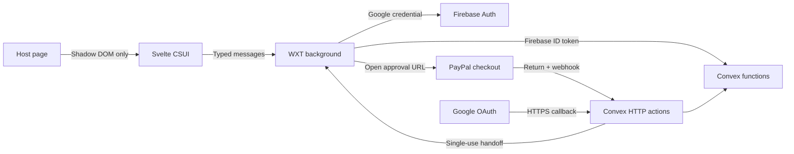
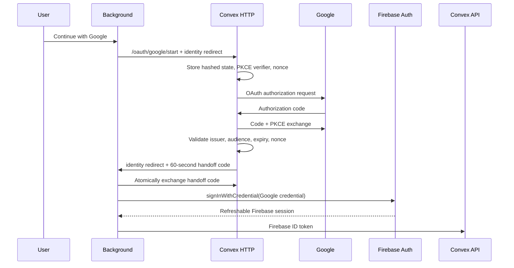
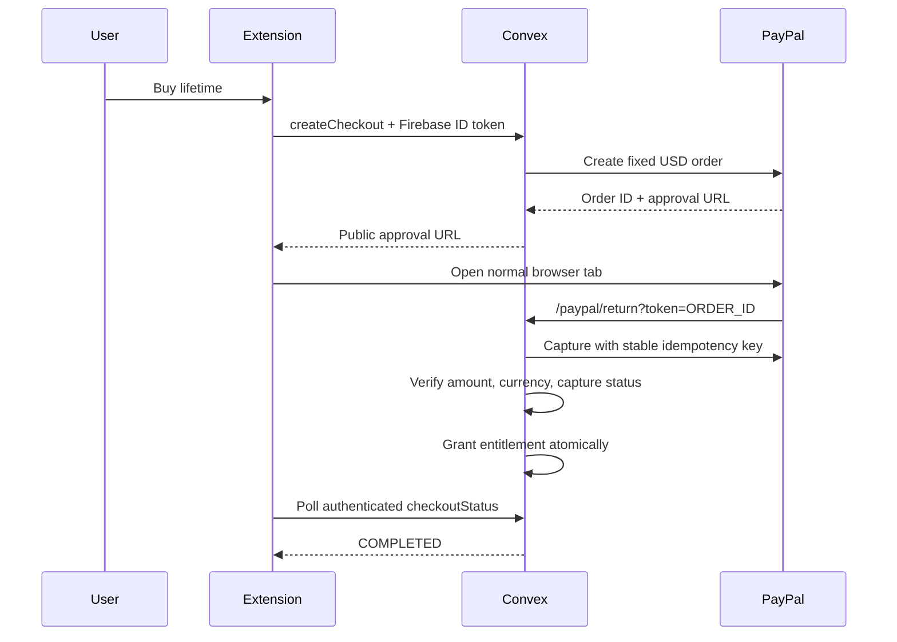

# Architecture

Status: working example
Last updated: 2026-08-25

## Mental Model And Scope

This repository demonstrates the smallest useful trust boundary for a Chrome and Firefox extension that uses:

- WXT and Svelte 5 for a shadow-root content-script UI
- Firebase Authentication for the user session
- `browser.identity.launchWebAuthFlow` for Google sign-in
- Convex for authenticated data and public HTTP callbacks
- PayPal Orders v2 for a fixed-price lifetime purchase

## System Map

The content script never receives Firebase tokens, Google tokens, or PayPal credentials. Focused background modules own authentication and purchasing; the service-worker entrypoint only registers typed message handlers. Each Google `sub` maps to a named Firebase app with its own SDK-managed persistent session. Each Convex operation creates a fresh HTTP client with the selected account's Firebase ID token.

## Component Responsibilities

| Component | Owns | May access | Must not access |
| --- | --- | --- | --- |
| Host page | The website being viewed | Its own DOM | Extension state and tokens |
| Svelte CSUI | Visible purchase state | Typed background messages | Firebase, Google, or PayPal credentials |
| Extension background | Browser identity and Firebase session | Firebase ID token, Convex API | PayPal merchant secret |
| Convex functions | User workflows and entitlements | Verified Firebase identity, database | Host-page DOM |
| Convex HTTP actions | Provider redirects and webhooks | Google and PayPal server credentials | Arbitrary client redirect destinations |
| Google and PayPal | Identity and payment processing | Data explicitly sent for those flows | Extension storage |

## Google Sign-In

Trigger: the user presses **Continue with Google**. Final state: Firebase Auth has a refreshable user session, and no Google secret is stored in the extension.

Firebase Auth is the account and session authority. Convex only accepts tokens issued by `securetoken.google.com/<FIREBASE_PROJECT_ID>`.

The verified Google `sub` keys a schema-validated local account index. A named Firebase app gives each account an isolated persistence namespace, while `local:activeGoogleSubject` records the explicit selection. Before storing an account, the extension verifies Firebase's `google.com` provider UID matches the broker-verified `sub`. No Google refresh token is manually stored.

Google's token response is parsed with Zod, then the ID token signature and claims are verified with `jose` against Google's remote JWKS. Issuer, audience, expiry, issued-at time, subject, and nonce are required before the credential reaches Firebase.

## PayPal Checkout

Trigger: an authenticated user presses **Buy lifetime with PayPal**. Final state: Convex stores an entitlement only after PayPal confirms a completed `9.99 USD` capture.

The PayPal client secret and access token never enter the extension. A return redirect alone grants nothing: Convex captures server-side and validates `9.99 USD` before writing the entitlement.

PayPal response schemas constrain documented resource IDs, HATEOAS relations, approval hosts, capture statuses, three-letter currencies, and decimal amounts. Webhooks are body-size bounded, require all signature headers, reject stale transmissions, and send the original parsed event to PayPal's verification API. A completed event for an unknown order returns `503` without consuming the event so PayPal can retry it. `paypal-transmission-time` is read with `Temporal.Instant.from`, which either accepts RFC 3339 or throws - `Date.parse` would fall back to implementation-defined heuristics on a header the replay window depends on.

### Checkout Refusals

Convex redacts a plain `Error`'s message in production, so a refusal only reaches the extension if it is stamped. `createCheckout` throws `ConvexError` carrying a `PaypalErrorCode` from `packages/shared`, and the extension maps that to the smaller set of things a refusal means to the member. Anything unstamped stays a plain `Error` on purpose and reads as `unavailable`.

| Backend code | UI kind | What the member is offered |
| --- | --- | --- |
| `already_entitled` | `alreadyOwned` | Refresh status |
| `country_not_supported` | `region` | Nothing - retrying cannot help |
| `unauthorized` | `signedOut` | Sign in again |
| `server_misconfigured` | `unavailable` | Try again |
| `paypal_error` | `unavailable` | Try again |
| *(unstamped, or a browser that will not open the tab)* | `unavailable` | Try again |

No kind blames the member's payment method: the card is never charged before PayPal's own approval page, so a decline cannot happen on this path. A failed id-token mint reads as `network` rather than as a dead session, since the session is still good.

## Trust Boundaries

| Boundary | Public data | Secret data | Enforcement |
| --- | --- | --- | --- |
| Extension bundle | Convex URLs, Firebase web config, browser IDs | None | `WXT_*` values are assumed readable |
| Convex environment | None | Google client secret, PayPal secret, webhook ID | Deployment environment variables |
| Content script | Display state | No auth or payment tokens | Typed background messages |
| Convex functions | Checkout result | Firebase identity | `ctx.auth.getUserIdentity()` |
| Provider callbacks | Opaque IDs | Provider credentials | State, PKCE, nonce, signature verification |

`@minimum-paypal/shared` contains only pure constants, enums, and Zod contracts. It is the single source of truth imported by both extension and backend, while browser APIs and provider clients remain in their owning workspaces. The refusal vocabulary lives there for the same reason the price does: the side that stamps a code and the side that reads it cannot drift if there is one definition.

## Data Model

| Table | Purpose | Important invariant |
| --- | --- | --- |
| `oauthTransactions` | Short-lived Google OAuth state | State is stored hashed and consumed once |
| `googleCredentialExchanges` | Extension handoff | Code is hashed, redirect-bound, expires in 60 seconds |
| `paypalCheckoutFlows` | User-to-order binding | Price and currency originate on the server |
| `webhookEvents` | PayPal event deduplication | One row per verified PayPal event ID |
| `entitlements` | Lifetime access | Written only after a validated completed capture |

## Follow Google Sign-In Through The Code

1. `App.svelte` sends `MessageType.AddGoogleAccount` through `@webext-core/messaging`.
2. `background/google-auth.ts` creates the browser redirect and calls `launchWebAuthFlow`.
3. `oauth.ts` brokers Google OAuth and returns a short-lived, single-use code.
4. `background/google-auth.ts` exchanges the code and validates the returned Google `sub` against Firebase provider data.
5. `background/accounts.ts` stores public account metadata and selects its named Firebase Auth instance.
6. `auth.config.ts` tells Convex to trust only this Firebase project's ID tokens.

## Follow Buy Lifetime Through The Code

1. `App.svelte` sends `MessageType.StartLifetimePurchase`.
2. `background/convex-client.ts` creates a fresh client with the current Firebase ID token.
3. `background/purchase.ts` calls the Convex action, stores the checkout identity, and answers with a result rather than throwing - an error crossing the messaging boundary arrives stripped of everything but its message.
4. `paypal.ts` creates the server-priced order and returns only its approval URL.
5. PayPal returns to `paypal.ts`, which captures and validates the payment.
6. `schema.ts` stores the completed flow and entitlement.
7. The CSUI polls without overlapping requests and renders completion, or renders the one screen `lib/payment-error.ts` picked for a refusal.

Both tours share payment vocabulary through `packages/shared/src/payment.ts`; neither side duplicates status strings, product amount, currency, or checkout response shapes.

## Failure And Recovery

| Failure | Recovery behavior |
| --- | --- |
| OAuth worker suspends | Transaction state is in Convex, not worker memory |
| OAuth handoff is replayed | Atomic consumption rejects the second exchange |
| OAuth handoff is delayed | The code expires after 60 seconds |
| PayPal create/capture response is ambiguous | The same stored idempotency key is reused |
| PayPal webhook is delivered twice | Event ID deduplication makes the second delivery a no-op |
| Completed webhook precedes its order binding | No event is consumed; `503` requests PayPal redelivery |
| PayPal verification is unavailable | A `5xx` response preserves provider retry behavior |
| Checkout tab is closed | The stored flow remains queryable; closing a tab is not cancellation |
| Checkout tab will not open | The pending order is kept and offered again, rather than left polling with nothing on screen |
| PayPal refuses to create the order | The refusal is named, and only the ones retrying can fix keep offering the button |
| Firebase id token will not mint | Read as a network failure; the card keeps the session it already had |
| `chrome.storage` rejects | The thrown error names the operation and key, with the native message as its cause |
| CSUI or browser restarts | WXT local storage keeps the checkout ID for a later status refresh |
| User switches accounts during checkout | Account-scoped storage hides the other account's checkout |
| One account is removed | Only that named Firebase session and purchase record are cleared |

## Deliberate Limits

- One product: lifetime access for `9.99 USD`
- No subscription example
- No refund or reversal revocation workflow
- No automated browser end-to-end test
- URL derivation has unit coverage; provider integrations still require sandbox tests
- OAuth and PayPal require deployed HTTPS callbacks, so provider flows cannot run against only localhost

These limits keep the example readable. Production systems should add rate limits, cleanup jobs, monitoring, refund/reversal handling, and dedicated development and production provider apps.
